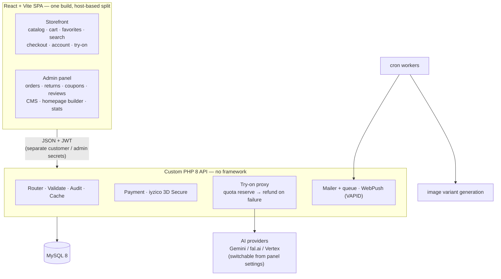

# Case study: fashion e-commerce with an AI virtual fitting room

A complete e-commerce platform built from scratch for a women's fashion boutique in Turkey — live in production and taking real orders. A React storefront and a full admin panel sit on top of a dependency-free custom PHP API, and the headline feature is an **AI virtual try-on**: the customer uploads a photo and sees herself wearing the garment, with identity preservation, cost caps and an automated quality gate handled server-side.

> **Case study only.** This was client work; the source code is private. This document describes the architecture and the engineering decisions.

---

## Problem

The boutique was selling through social media DMs and a hosted storefront, with no owned platform: no product catalog under their control, no customer accounts, no order pipeline, and no way to stand out from thousands of similar shops. The brief grew into four goals:

1. A fast, polished storefront with real checkout (card payments included) — not a link-out.
2. A full back office the owner could actually run: orders, returns, coupons, reviews, content, statistics.
3. Something nobody else in their segment had — this became the AI fitting room.
4. All of it operable on ordinary shared-style hosting with a tiny budget.

## Architecture

- **One build, two apps.** The same Vite bundle serves the storefront and the admin panel; the hostname decides which app boots. One deploy, one cache story.
- **Framework-free API by choice.** 19 small hand-rolled library classes (Router, Jwt, Db, Validate, Audit, Cache, Mailer, WebPush, Payment, Iyzico, TryOn, Media, …) behind 18 route files split into public and admin surfaces. On cheap PHP hosting this beats dragging in a framework: no build step, no vendor tree, instant cold start, and every line is accountable.
- **Separate JWT secrets** for customer and admin sessions, with short-lived access tokens and refresh rotation. A leaked customer token can never become a panel session.
- **Real payments**: four methods (card via iyzico with the full 3D Secure round-trip, bank transfer, cash on delivery, manual), each toggleable from the panel.

## The AI fitting room — the interesting part

The customer uploads one photo on the product page and receives a photorealistic image of **herself wearing that exact garment**. What it took to make this production-safe:

- **Keys never reach the browser.** The try-on endpoint is a server-side proxy; provider API keys live only in server settings — even the admin API won't return the raw values.
- **Provider-agnostic engine.** Gemini (default), fal.ai, or Vertex AI through a small Cloud Run broker — the provider and model name are panel settings, so switching costs zero code changes.
- **Reserve-first, refund-on-failure quotas.** A hard daily cap plus a per-visitor daily cap are enforced with file-locked counters. The quota slot is *reserved before* the provider call and refunded if generation fails — a provider outage can never burn the day's budget, and two concurrent requests can never sneak past the cap.
- **Identity preservation as a hard rule.** The generation prompt treats the face as untouchable — same features, expression, skin, hair, pose, background; only the garment changes, and the old outfit must be erased completely. Getting this reliable was prompt engineering as product work, not a one-liner.
- **A model-as-judge quality gate.** Every result goes through a second pass — a strict "quality inspector" prompt comparing the output against the original photo. Failures trigger an automatic regeneration instead of reaching the customer.
- **An end-to-end time budget.** The client aborts at 150 s; the server chain (rate-limit backoff + possible regeneration) tracks its own deadline so it can never finish *after* the client gave up — because then the customer would pay a credit for an image she never saw.
- **Safety thresholds tuned on production data.** Default content-safety settings flagged legitimate lingerie products; thresholds were adjusted to block only high-probability violations after observing real traffic.
- Customer photos are used only for the generation request and are not stored server-side.

There is also a zero-cost fallback mode that runs entirely in the browser: a canvas-composited "style card" with rule-based styling analysis — no network call, the photo never leaves the device.

## My role

Sole developer and operator: storefront, admin panel, API, payment integration, the try-on engine, mail queue, push notifications, deployment scripts and production operations.

## Stack

| Layer | Technology |
|---|---|
| Frontend | React 18, Vite, Tailwind CSS v4, react-router |
| Admin dashboard | Recharts statistics, live order feed, web push on new orders |
| API | PHP 8 — custom micro-framework (router, JWT, validation, audit log, cache) |
| Database | MySQL 8 |
| Payments | iyzico 3D Secure · bank transfer · cash on delivery · manual |
| AI try-on | Gemini / fal.ai / Vertex behind a server-side proxy with quota accounting |
| Async | Cron-driven mail queue and responsive image-variant generation |
| Chat | Rule-based styling chatbot (knowledge base + deterministic engine, zero API cost) |
| Secrets | git-crypt encrypted in-repo; runtime config never committed |

## Results

- Live in production, processing real orders with real card payments.
- The boutique runs its entire operation (orders, returns, coupons, reviews, content, campaigns) from the panel without developer involvement.
- The fitting room runs within a fixed daily budget by construction — cost control is enforced by the counter design, not by hoping.

## Lessons learned

1. **Reserve-first beats check-then-call.** Checking a quota and then calling the provider is a race; reserving the slot first (and refunding on failure) makes the cap exact under concurrency and provider failures.
2. **Generative features need a quality gate, not just a prompt.** The inspector pass turned "usually looks right" into "what the customer sees has been checked against her original photo".
3. **Time budgets must be designed end-to-end.** Every retry layer on the server has to fit inside the client's patience, or you charge people for results they never see.
4. **Safety filters are a product setting.** Defaults tuned for general content block legitimate fashion items; thresholds are something you tune on real traffic, deliberately.
5. **On constrained hosting, less framework is more.** A small, fully-owned PHP core gave instant deploys and no dependency surface — the right trade for this environment, and a deliberate one.
